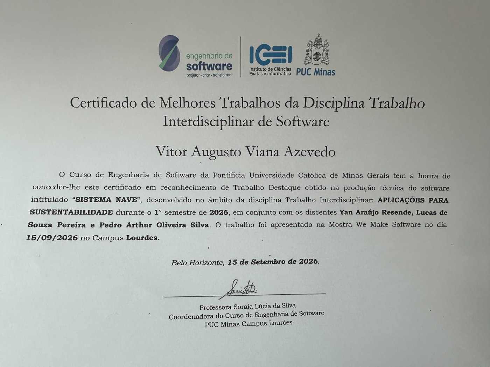
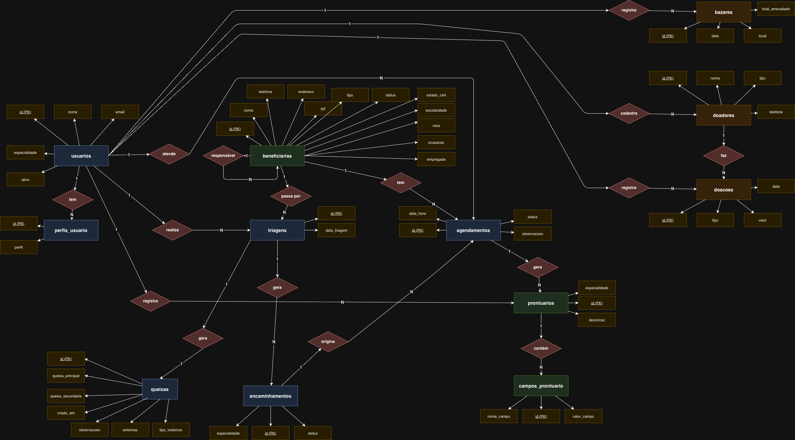
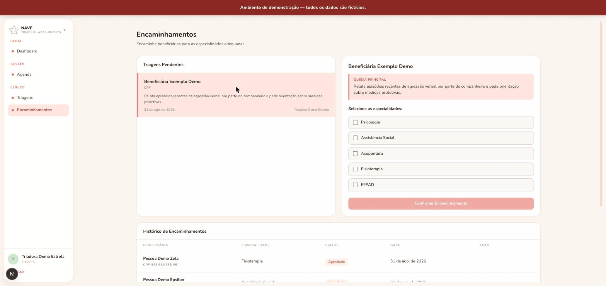
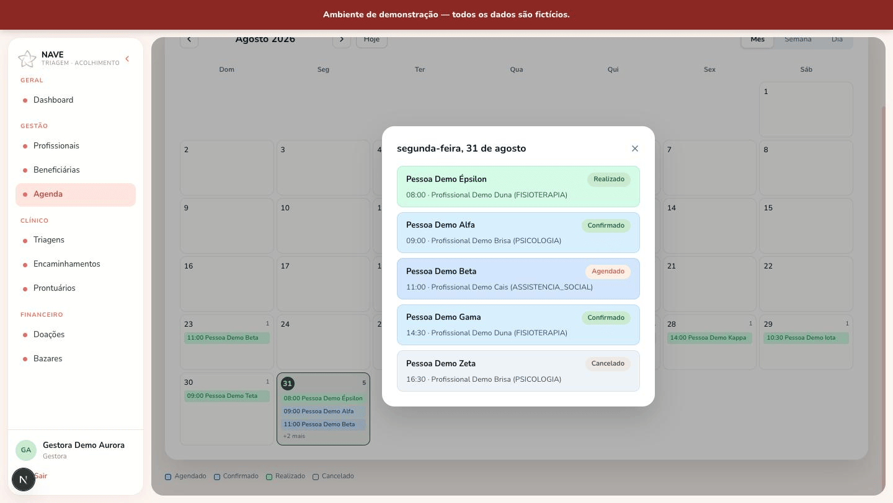
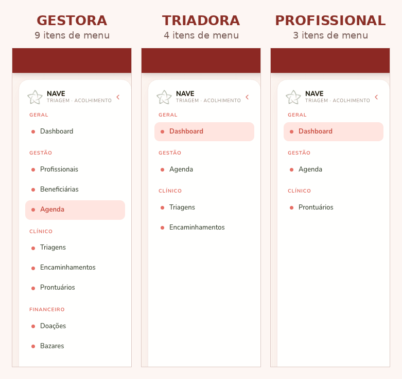
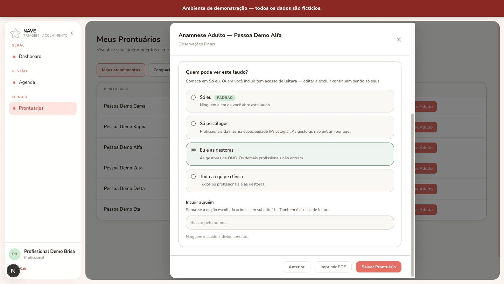

# NAVE System

[Português](README.md) · **English**

Management system for **Núcleo Assistencial Veleiro da Esperança (NAVE)**, a non-profit in Belo Horizonte, Brazil, that supports women, children and teenagers facing domestic violence. The organization used to run on paper forms and WhatsApp groups. Scheduling, intake, referrals, clinical records and donations now live in one system, with access control designed for sensitive clinical data.

> **Portfolio repository, published with the organization's permission.** The code is the same as the production system, but all data is fictional: no real client, staff member, donor or third party appears here.

  
   
  ▶ Click to watch the full video (MP4, 720p, UI in Portuguese)

## Highlights

- **In real use, and award-winning.** It started as a university project, won the Outstanding Project award at PUC Minas' Mostra We Make Software showcase and became the system the non-profit uses every day (see [History](#history)).
- **Clinical-record access by role × specialty.** Every record has one of four visibility levels, plus sharing with named people. When access is denied, the API returns only the record's metadata, never its content.
- **Security proven by tests.** End-to-end tests run against a real PostgreSQL database and cover the visibility matrix, role guards, access revocation for deactivated users and input validation.
- **Secure password recovery.** Single-use emailed link stored only as a hash, with request rate limiting; resetting the password revokes every open session.
- **Easy to evaluate.** `docker compose up --build` starts the database, API and UI with demo data already loaded. API docs are served at `/docs` (OpenAPI).
- **Full CI.** On every push, GitHub Actions runs lint, type checks, backend and frontend unit tests, migrations, e2e tests, builds and a smoke test of the Docker stack.

<table>
  <tr>
    <td width="50%" valign="middle" align="center"></td>
    <td width="50%" valign="middle" align="center"></td>
  </tr>
  <tr>
    <td align="center">Outstanding Project certificates, Sept 15, 2026</td>
    <td align="center">Certificate issued by the program coordinator (in Portuguese)</td>
  </tr>
  <tr>
    <td colspan="2" align="center"></td>
  </tr>
  <tr>
    <td colspan="2" align="center">Presentation at the Mostra We Make Software showcase, Lourdes campus. <a href="https://www.linkedin.com/feed/update/urn:li:activity:7511815812765093888/">Video of the presentation on LinkedIn</a> (in Portuguese).</td>
  </tr>
</table>

## Run it with one command

Requires Docker with Docker Compose.

~~~bash
git clone https://github.com/vitorazevedop7/nave-demo.git
cd nave-demo
docker compose up --build
~~~

| What | Where |
| --- | --- |
| UI | <http://localhost:3000> |
| API | <http://localhost:3001> |
| API docs (Swagger) | <http://localhost:3001/docs> |

Every demo user has the password **NaveDemo@2026**. It is public and exists only for the local demo.

| Role | E-mail |
| --- | --- |
| Manager (GESTORA) | `gestora.demo@example.com` |
| Practitioner, Psychology (PROFISSIONAL) | `profissional.psi.demo@example.com` |
| Intake worker (TRIADORA) | `triadora.demo@example.com` |

The seed also creates fictional Social Work and Physiotherapy practitioners, to populate the schedule, the referrals and the specialty-based rules.

## Architecture

~~~text
┌──────────────────────┐   HTTP/JSON + JWT   ┌──────────────────────────┐   Prisma   ┌────────────┐
│ Next.js 16 / React 19│ ──────────────────▶ │ NestJS 11                │ ─────────▶ │ PostgreSQL │
│ App Router, Tailwind │                     │ Global guards (JWT,      │            │ 19 tables  │
│ Recharts             │ ◀────────────────── │ roles), validated DTOs,  │ ◀───────── │ migrations │
└──────────────────────┘                     │ Prisma error filter      │            └────────────┘
                                             └──────────────────────────┘
~~~

| Layer | Technology |
| --- | --- |
| Frontend | Next.js 16, React 19, TypeScript, Tailwind CSS 4, Recharts |
| Backend | NestJS 11, Passport + JWT, class-validator, Swagger/OpenAPI, Helmet, Throttler |
| Data | PostgreSQL, Prisma 7 with the `pg` adapter, versioned migrations |
| Quality | Jest, Supertest, Vitest, Testing Library, type-checked ESLint, Prettier, GitHub Actions, Docker |

Security is enforced on the backend. The UI hides menu items a role can't use, but that's a convenience, not protection. A global guard authenticates every route, and restricted routes also go through a `RolesGuard`. The token is checked against the database on every request, so a deactivated user loses access immediately instead of when the token expires.

## Domain

The core flow follows a client through the organization: **registration → intake (complaint) → referral by specialty → appointment → session → clinical record**. Administrative modules cover users and roles, donors, donations, campaigns and charity bazaars.

The [logical model](docs/README.md) (in Portuguese) documents tables, attributes and relationships in detail. Clients and clinical records are soft-deleted (`deletado_em`), because clinical history must never disappear along with a registration.

<table>
  <tr>
    <td></td>
    <td></td>
  </tr>
  <tr>
    <td align="center">Referral by specialty</td>
    <td align="center">Schedule with the four appointment statuses</td>
  </tr>
</table>

## Clinical-record access control

The system has three functional roles:

- **GESTORA (manager):** manages users and the organization's processes and has access to the management areas.
- **TRIADORA (intake worker):** registers clients and records intakes, complaints and referrals.
- **PROFISSIONAL (practitioner):** follows their own schedule and writes clinical records for their specialty.

Each record has one of four visibility levels, chosen by the practitioner who wrote it:

| Visibility | Who can read the content |
| --- | --- |
| **PRIVADO** | Only the author, unless explicitly shared. |
| **ESPECIALIDADE** | Practitioners with the record's specialty. |
| **GESTORAS** | Users with the manager role. |
| **EQUIPE_CLINICA** | Managers and practitioners. |

Authorship and sharing with named people grant access at any level. Only the author can edit or delete a record, even after it has been shared.

**Why combine role and specialty?** They answer different questions. The role says what a person can do in the organization; the specialty says in which technical context they work. Authorizing by the practitioner role alone would open every clinical record to the whole team. Authorizing by specialty alone would leave out legitimate management duties. Combining them gives least privilege without getting in the way of the work, and exceptions are handled by sharing with named people instead of widening access for a whole role.

## Quality and security

| | |
| --- | --- |
| Tests | Backend: 154 unit and 116 e2e tests (API + real PostgreSQL). Frontend: 91 logic and component tests |
| API | 65 REST routes documented with OpenAPI (`/docs`) |
| Authentication | JWT with the user re-validated against the database on every request, bcrypt, login rate limiting |
| Input | Whitelisted DTOs (unknown fields rejected), `ParseUUIDPipe`, Prisma errors mapped to 404/409 |
| Headers | Helmet; CORS restricted to the frontend origin |
| Sensitive data | Per-role data minimization (donor tax IDs and contacts only for those who need them), clinical drafts kept in `sessionStorage` and cleared on logout, clinical-record PDFs built with HTML escaping and a CSP |

## Local development

Requires Node.js 20.19+ and Docker (or your own PostgreSQL).

~~~bash
# 1. Database
docker compose up -d postgres            # PostgreSQL on port 5433

# 2. API
cd backend
cp .env.example .env                      # set JWT_SECRET with: openssl rand -hex 32
npm install
npx prisma migrate deploy
npm run seed
npm run start:dev                         # http://localhost:3001

# 3. UI (in another terminal)
cd frontend
cp .env.example .env.local
npm install
npm run dev                               # http://localhost:3000
~~~

Tests:

~~~bash
cd backend
npm test                                  # unit
npm run test:e2e                          # e2e: point DATABASE_URL at a disposable database
npm run lint:check

cd ../frontend
npm test                                  # screen logic and components (Vitest)
~~~

## History

The system began in the first semester of 2026 as a project for the *Interdisciplinary Project: Applications for Sustainability* course in the Software Engineering program at PUC Minas, with the non-profit as a real client. The team was Vitor Augusto Viana Azevedo, Yan Araújo Resende, Lucas de Souza Pereira and Pedro Arthur Oliveira Silva. The project won the **Outstanding Project** award at the Mostra We Make Software showcase in September 2026.

After the course, the non-profit hired me to rebuild the system for real use. This repository is that version. It was published without its original commit history so that no real data from the organization would remain in Git history.

## Documentation

These documents are in Portuguese:

- [Technical documentation](DOCUMENTACAO_TECNICA.md): architecture, endpoints, access rules and operations
- [User manual](MANUAL_USUARIO.md): guide for the non-profit's staff
- [Requirements](docs/requisitos.md), [use cases](docs/casos-de-uso.png), [ER diagram](docs/der.png) and [logical model](docs/README.md), which I produced while engineering the system

## Author

**Vitor Augusto Viana Azevedo**, Software Engineering student at PUC Minas and full-stack developer. Open to internships and freelance projects.
[LinkedIn](https://www.linkedin.com/in/vitorvianaazevedo) · [GitHub](https://github.com/vitorazevedop7)

Released under the [MIT License](LICENSE).
