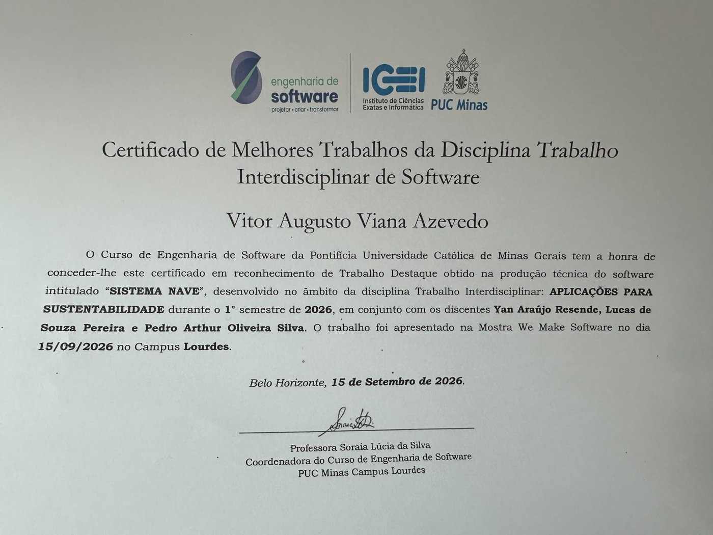
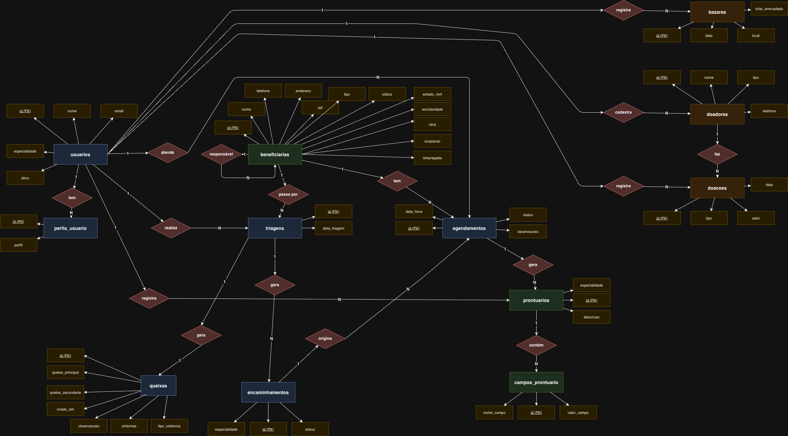
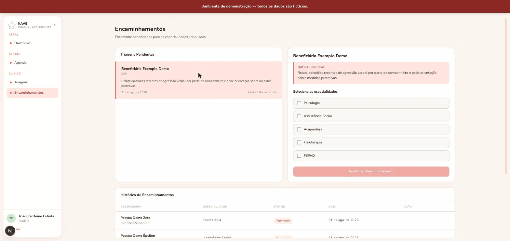
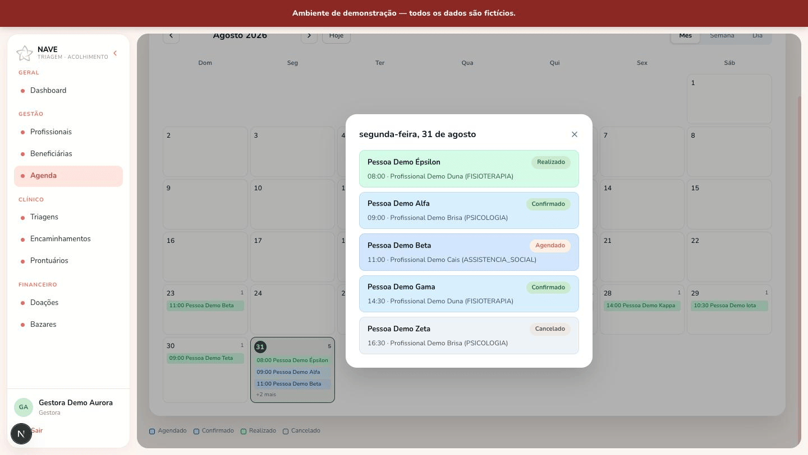
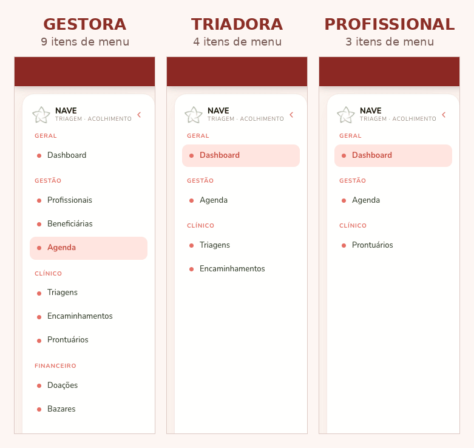
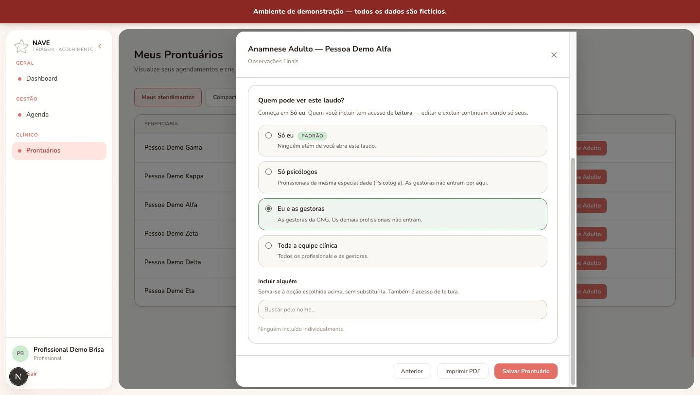

# Sistema NAVE

**Português** · [English](README.en.md)

Sistema de gestão do **Núcleo Assistencial Veleiro da Esperança (NAVE)**, uma ONG de Belo Horizonte que atende mulheres, crianças e adolescentes em situação de violência familiar. A ONG trabalhava com fichas em papel e grupos de WhatsApp. Hoje agenda, triagem, encaminhamentos, prontuários e doações ficam num único sistema, com controle de acesso pensado para dados clínicos sensíveis.

> **Repositório de portfólio publicado com autorização da ONG.** O código é o mesmo do sistema em uso, mas todos os dados são fictícios: nenhuma pessoa atendida, profissional, doador ou terceiro real aparece aqui.

  
   
  ▶ Clique para ver o vídeo completo (MP4, 720p)

## Destaques

- **Em uso real e premiado.** Começou como projeto acadêmico, foi escolhido como Trabalho Destaque na Mostra We Make Software da PUC Minas e virou o sistema que a ONG usa no dia a dia (veja [Histórico](#histórico)).
- **Acesso a prontuários por perfil × especialidade.** Cada laudo tem um de quatro níveis de visibilidade, com compartilhamento nominal. Quando o acesso é negado, a API devolve só os metadados do registro, nunca o conteúdo.
- **Segurança verificada em teste.** Os testes e2e rodam contra um PostgreSQL real e cobrem a matriz de visibilidade, os guards de perfil, a revogação de acesso de usuários desativados e a validação de entrada.
- **Recuperação de senha segura.** Link de uso único por e-mail, guardado no banco só como hash, com limite de pedidos; redefinir a senha derruba todas as sessões abertas.
- **Pronto para avaliar.** `docker compose up --build` sobe banco, API e interface já com dados de demonstração. A documentação da API fica em `/docs` (OpenAPI).
- **CI completo.** O GitHub Actions roda lint, checagem de tipos, testes unitários, migrations, testes e2e, builds e um smoke test da stack Docker a cada push.

<table>
  <tr>
    <td width="50%" valign="middle" align="center"></td>
    <td width="50%" valign="middle" align="center"></td>
  </tr>
  <tr>
    <td align="center">Entrega dos certificados de Trabalho Destaque, 15/09/2026</td>
    <td align="center">Certificado emitido pela coordenação do curso</td>
  </tr>
  <tr>
    <td colspan="2" align="center"></td>
  </tr>
  <tr>
    <td colspan="2" align="center">Apresentação na Mostra We Make Software, Campus Lourdes. <a href="https://www.linkedin.com/feed/update/urn:li:activity:7511815812765093888/">Vídeo da apresentação no LinkedIn</a>.</td>
  </tr>
</table>

## Rodando em um comando

Requisito: Docker com Docker Compose.

~~~bash
git clone https://github.com/vitorazevedop7/nave-demo.git
cd nave-demo
docker compose up --build
~~~

| O quê | Onde |
| --- | --- |
| Interface | <http://localhost:3000> |
| API | <http://localhost:3001> |
| Documentação da API (Swagger) | <http://localhost:3001/docs> |

Todos os usuários de demonstração usam a senha **NaveDemo@2026**. Ela é pública e existe só para a demo local.

| Perfil | E-mail |
| --- | --- |
| Gestora | `gestora.demo@example.com` |
| Profissional (Psicologia) | `profissional.psi.demo@example.com` |
| Triadora | `triadora.demo@example.com` |

O seed também cria profissionais fictícios de Assistência Social e Fisioterapia, para popular a agenda, os encaminhamentos e as regras por especialidade.

## Arquitetura

~~~text
┌──────────────────────┐   HTTP/JSON + JWT   ┌──────────────────────────┐   Prisma   ┌────────────┐
│ Next.js 16 / React 19│ ──────────────────▶ │ NestJS 11                │ ─────────▶ │ PostgreSQL │
│ App Router, Tailwind │                     │ Guards globais (JWT,     │            │ 19 tabelas │
│ Recharts             │ ◀────────────────── │ perfis), DTOs validados, │ ◀───────── │ migrations │
└──────────────────────┘                     │ filtro de erros Prisma   │            └────────────┘
                                             └──────────────────────────┘
~~~

| Camada | Tecnologia |
| --- | --- |
| Frontend | Next.js 16, React 19, TypeScript, Tailwind CSS 4, Recharts |
| Backend | NestJS 11, Passport + JWT, class-validator, Swagger/OpenAPI, Helmet, Throttler |
| Dados | PostgreSQL, Prisma 7 com adapter `pg`, migrations versionadas |
| Qualidade | Jest, Supertest, ESLint (type-checked), Prettier, GitHub Actions, Docker |

A segurança fica no backend. O frontend esconde do menu o que o perfil não pode usar, mas isso é conveniência, não proteção: toda rota é protegida por um guard global de autenticação, e as rotas restritas também passam pelo `RolesGuard`. A cada requisição o token é conferido contra o banco, então um usuário desativado perde o acesso na hora, e não só quando o token expira.

## Domínio

O fluxo principal acompanha o caminho de uma beneficiária na ONG: **cadastro → triagem (queixa) → encaminhamento por especialidade → agendamento → atendimento → prontuário**. Os módulos administrativos cobrem usuários e perfis, doadores, doações, campanhas e bazares.

O [modelo lógico](docs/README.md) documenta tabelas, atributos e relações em detalhe. Beneficiárias e prontuários usam exclusão lógica (`deletado_em`), porque o histórico clínico nunca deve sumir junto com um cadastro.

<table>
  <tr>
    <td></td>
    <td></td>
  </tr>
  <tr>
    <td align="center">Encaminhamento por especialidade</td>
    <td align="center">Agenda com os quatro status de atendimento</td>
  </tr>
</table>

## Controle de acesso aos prontuários

O sistema tem três perfis funcionais:

- **GESTORA:** administra usuários e processos da organização e acessa as áreas de gestão.
- **TRIADORA:** cadastra beneficiárias e registra triagens, queixas e encaminhamentos.
- **PROFISSIONAL:** acompanha a própria agenda e registra prontuários da sua especialidade.

Cada prontuário tem um de quatro níveis de visibilidade, escolhido por quem atendeu:

| Visibilidade | Quem pode ler o conteúdo |
| --- | --- |
| **PRIVADO** | Só a autora, salvo compartilhamento explícito. |
| **ESPECIALIDADE** | Profissionais da mesma especialidade do prontuário. |
| **GESTORAS** | Usuários com perfil GESTORA. |
| **EQUIPE_CLINICA** | Usuários com perfil GESTORA ou PROFISSIONAL. |

A autoria e o compartilhamento nominal dão acesso em qualquer nível. Só a autora edita ou exclui o laudo, mesmo que ele tenha sido compartilhado com outras pessoas.

**Por que cruzar perfil e especialidade?** Os dois respondem a perguntas diferentes. O perfil diz o que a pessoa pode fazer na organização; a especialidade diz em que contexto técnico ela atua. Autorizar só pelo perfil PROFISSIONAL abriria todos os registros clínicos para a equipe inteira. Autorizar só pela especialidade deixaria de fora responsabilidades legítimas da gestão. Cruzando os dois, o sistema aplica o menor privilégio sem travar o trabalho, e os casos excepcionais se resolvem com compartilhamento nominal, sem ampliar o acesso de um perfil inteiro.

## Qualidade e segurança

| | |
| --- | --- |
| Testes | 154 testes unitários e 116 testes e2e (API + PostgreSQL real) |
| API | 65 rotas REST documentadas em OpenAPI (`/docs`) |
| Autenticação | JWT com usuário revalidado no banco a cada requisição, bcrypt e limite de tentativas no login |
| Entrada | DTOs com whitelist (campos não declarados são rejeitados), `ParseUUIDPipe`, erros do Prisma convertidos em 404/409 |
| Cabeçalhos | Helmet e CORS restrito à origem do frontend |
| Dados sensíveis | Minimização por perfil (CPF e contatos de doadores só para quem precisa), rascunhos clínicos em `sessionStorage` apagados no logout, PDF de prontuário gerado com escape de HTML e CSP |

## Desenvolvimento local

Requisitos: Node.js 20.19+ e Docker (ou um PostgreSQL próprio).

~~~bash
# 1. Banco
docker compose up -d postgres            # PostgreSQL na porta 5433

# 2. API
cd backend
cp .env.example .env                      # preencha JWT_SECRET com: openssl rand -hex 32
npm install
npx prisma migrate deploy
npm run seed
npm run start:dev                         # http://localhost:3001

# 3. Interface (em outro terminal)
cd frontend
cp .env.example .env.local
npm install
npm run dev                               # http://localhost:3000
~~~

Testes:

~~~bash
cd backend
npm test                                  # unitários
npm run test:e2e                          # e2e: use um DATABASE_URL de banco descartável
npm run lint:check
~~~

## Histórico

O sistema nasceu em 2026/1 como projeto da disciplina *Trabalho Interdisciplinar: Aplicações para Sustentabilidade*, do curso de Engenharia de Software da PUC Minas, com a ONG como cliente real. A equipe era formada por Vitor Augusto Viana Azevedo, Yan Araújo Resende, Lucas de Souza Pereira e Pedro Arthur Oliveira Silva. O projeto foi premiado como **Trabalho Destaque** na Mostra We Make Software, em setembro de 2026.

Depois da disciplina, a ONG me contratou para reconstruir o sistema para uso real. Este repositório é essa versão. Ele foi publicado sem o histórico de commits original, para que nenhum dado real da organização ficasse no histórico do Git.

## Documentação

- [Documentação técnica](DOCUMENTACAO_TECNICA.md): arquitetura, endpoints, regras de acesso e operação
- [Manual do usuário](MANUAL_USUARIO.md): guia para quem usa o sistema na ONG
- [Requisitos](docs/requisitos.md), [casos de uso](docs/casos-de-uso.png), [DER](docs/der.png) e [modelo lógico](docs/README.md), produzidos por mim durante a engenharia do sistema

## Autor

**Vitor Augusto Viana Azevedo**, estudante de Engenharia de Software na PUC Minas e desenvolvedor full-stack.
[LinkedIn](https://www.linkedin.com/in/vitorvianaazevedo) · [GitHub](https://github.com/vitorazevedop7)

Licenciado sob a [Licença MIT](LICENSE).
